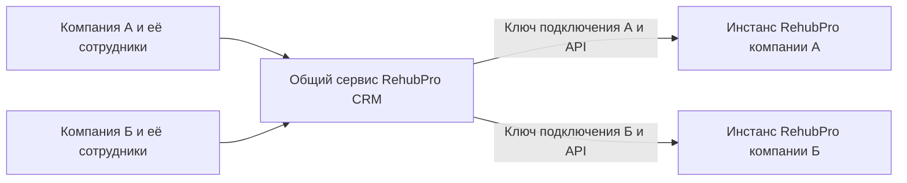

# RehubPro CRM

План отдельной CRM для реабилитационных центров. Компании работают в общем сервисе с изоляцией данных, а подтверждённых клиентов передают в свои инстансы RehubPro через API.

Статус на 13 ноября 2026 года: реализован первый рабочий этап — регистрация с подтверждением почты, вход и восстановление пароля, компании, роли сотрудников, приглашения, отключение доступа и журнал действий. Есть Django API и интерфейс Next.js. Добавлены карточки клиентов и родственников, обращения, воронка, ответственные, поиск, следующий контакт и история комментариев. Добавлены задачи менеджера, напоминания внутри открытой CRM и сводка компании. Цвета приведены к палитре RehubPro. Реализованы настройки центров и очередь передачи в RehubPro с подтверждением, журналом попыток и защитой от повторов. Для работы с действующим центром необходимо установить и включить новый приёмник на этом центре.

## Предлагаемая схема продукта

- **RehubPro CRM** — обращения, контакты, воронка, задачи менеджеров, подготовка поступления.
- **RehubPro** — резиденты, реабилитационная программа, отчёты, психолог, СОЗА и текущий финансовый учёт центра.
- **rehubpro_core** — предполагаемый контур управления развёртываниями; его фактическую реализацию ещё нужно изучить после получения доступа.

CRM может использоваться самостоятельно. Подключение RehubPro добавляет передачу клиента в центр. Разделение продуктов не требует отдельных серверов для каждой компании и не определяет тарифы.



Внутри CRM изоляцию обеспечивает принадлежность каждой записи компании и проверка доступа на сервере. На схеме показаны отдельные подключения, а не общий доступ компаний к данным друг друга.

## Документы

- [План продукта и разработки](docs/PLAN.md) — регистрация, роли, модель данных, этапы и критерии готовности.
- [Передача клиента в RehubPro](docs/INTEGRATION.md) — подключение по ключам, контракт API, повторы и обработка ошибок.
- [Разбор существующего проекта](docs/CURRENT_SYSTEM.md) — проверенные точки кода и вопросы к инфраструктуре.

## Локальный запуск

Нужны Python 3.10 или новее, Node.js 22 или новее и npm. Команды выполняются из этой папки. Для первой подготовки:

```bash
./scripts/setup.sh
./scripts/dev.sh
```

Откройте [CRM](http://127.0.0.1:3100). API работает на `127.0.0.1:8100`. Эти порты и конфигурация отдельные от RehubPro. `Ctrl+C` останавливает оба процесса.

Если системный Python слишком старый, укажите подходящий интерпретатор при подготовке:

```bash
CRM_PYTHON=/absolute/path/to/python3 ./scripts/setup.sh
```

`setup.sh` создаёт `.venv` и локальный `.env` со случайными ключами, устанавливает зафиксированные зависимости и выполняет миграции **только базы CRM**. Имеющийся `.env` не перезаписывается. По умолчанию разработка работает на отдельном SQLite-файле `backend/db.sqlite3`.

Письма регистрации, восстановления и приглашения выводятся в терминал сервера. Откройте полную ссылку из письма и подтвердите действие. На настоящие почтовые адреса в этом режиме ничего не отправляется. Повторная регистрация до подтверждения делает предыдущую ссылку недействительной.

## Разработка с PostgreSQL

После подготовки окружения:

```bash
docker compose up -d db
```

В локальном `.env` установите `CRM_DB_ENGINE=postgres`, затем выполните миграции:

```bash
cd backend
../.venv/bin/python manage.py migrate
```

Контейнер CRM использует отдельный volume `rehubpro-crm_crm_postgres` и локальный порт `55440`. Смена движка не переносит данные из SQLite; оба режима предназначены для разработки. Не подключайте CRM к базе существующего RehubPro.

## Проверки

```bash
cd backend
../.venv/bin/python manage.py check
../.venv/bin/python manage.py makemigrations --check --dry-run
../.venv/bin/python manage.py test crm.tests
```

Для тестов PostgreSQL поднимите `db`, затем запустите из `backend`:

```bash
CRM_DB_ENGINE=postgres ../.venv/bin/python manage.py test crm.tests --noinput
```

Тесты используют отдельную временную базу `test_rehubpro_crm`. Конкурентные транзакции проверяются на PostgreSQL; на SQLite эти два сценария пропускаются.

```bash
cd web
npm run typecheck
npm run build
```

## Границы первого этапа

Роль сотрудника хранится в членстве компании. Аккаунт может состоять в нескольких компаниях с разными ролями; переключатель показывает только доступные компании. Владелец и администратор приглашают сотрудников, отзывают приглашения и отключают доступ. Владельца и собственный доступ отключить через этот экран нельзя. Смена ролей и передача владения пока не реализованы.

После регистрации создаётся основной филиал. Создание дополнительных компаний из существующего аккаунта и редактирование филиалов появятся отдельными функциями; пока вторую компанию можно получить через приглашение.

Интерфейс содержит только реальные данные компании. Воронка и карточки доступны в навигации; подключение центров и передача доступны после настройки приёмника. Библиотеки Celery и Redis будут добавлены вместе с фоновой доставкой.

## Перед рабочим запуском

Текущее окружение — локальная версия для разработки. Перед размещением нужны HTTPS, SMTP, резервное копирование с проверкой восстановления, конфигурация reverse proxy и наблюдение за ошибками. При `CRM_DEBUG=0` приложение требует постоянный секрет, PostgreSQL и SMTP. Базы SQLite и PostgreSQL, использованные для локальной проверки, содержат только синтетические данные.

API использует сессии Django и CSRF-защиту. Next.js направляет `/api/` на Django в том же origin. `CRM_BACKEND_URL` задаётся в окружении процесса Next.js, если сервер API находится по другому адресу. [Django CSRF](https://docs.djangoproject.com/en/5.2/howto/csrf/), [Next.js rewrites](https://nextjs.org/docs/app/api-reference/config/next-config-js/rewrites).

Ограничения частоты запросов хранятся в базе и действуют между процессами. Сейчас адрес берётся из непосредственного соединения, без доверия пользовательским proxy-заголовкам. При развёртывании через прокси нужно настроить ограничение по реальному адресу на доверенном входе; иначе пользователи делят общую квоту прокси. Нужна также периодическая очистка старых счётчиков и истёкших регистраций.

Отправка писем пока синхронная: приглашение сохраняется транзакционно, SMTP-ошибка возвращается пользователю. Гарантированная доставка писем с outbox и повторами ещё не реализована. Перед пилотом требуется проверка SMTP и доставки писем. Общий сервис не следует считать прошедшим полный аудит безопасности на основании этих тестов.

Подробная структура нового модуля и принятые решения: [Архитектура клиентов и обращений](docs/ARCHITECTURE.md).

Подключение центра, ключи, исполнитель очереди и сквозные тесты: [Интеграция с RehubPro](docs/INTEGRATION.md).
